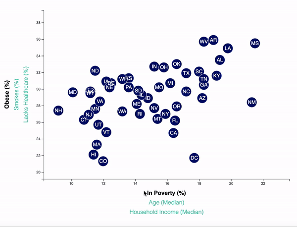

# Data Journalism with D3: Health Risks vs. Demographics


An interactive D3 scatter plot exploring how **poverty, income and age** relate to **obesity, smoking and lack of healthcare** across the 50 US states and the District of Columbia.

🔗 **[Live demo](https://ermiasgelaye.github.io/D3-challenge/)**



## Key findings

Pearson correlations across the 51 states and DC:

| | Obesity | Smoking | Lacks healthcare |
|---|---:|---:|---:|
| **Poverty rate** | +0.46 | +0.52 | +0.52 |
| **Median household income** | **−0.65** | **−0.66** | −0.43 |
| **Median age** | −0.01 | +0.25 | −0.39 |

- **Poorer states carry more health risk.** Higher poverty goes with higher obesity, smoking and lack of healthcare.
- **Income is the strongest signal.** Higher median household income is strongly associated with lower obesity and smoking.
- **Age tells us little.** State median ages fall in a narrow band (30.5–44.1, mostly 36–39). Age has no relationship with obesity, a weak positive one with smoking, and a moderate negative one with lack of healthcare.

These patterns match the broader research consensus that socioeconomic status, meaning income, education and occupation, is closely tied to health outcomes, including disease risk and premature death (Cowan et al., 2012; Wagstaff, 2002).

## Features

- **Six switchable axes.** Click any label to swap the x-axis (poverty, age, income) or the y-axis (obesity, smoking, lacks healthcare). The active label turns black.
- **Animated transitions.** Points, axes and state labels animate to their new positions.
- **Tooltips.** Hover over a state to see its exact values ([d3-tip](https://github.com/caged/d3-tip)).


## Run locally

Browsers block loading the CSV from `file://` URLs, so serve the folder over HTTP:

```bash
git clone https://github.com/ermiasgelaye/D3-challenge.git
cd D3-challenge
python -m http.server 8000      # then open http://localhost:8000
```

## Project structure

```
D3-challenge/
├── index.html
├── d3time.png               # logo / favicon
└── assets/
    ├── js/app.js            # chart, axis switching, transitions, tooltips
    ├── css/                 # page and D3 styles
    └── data/data.csv        # state-level dataset
```

## Data

State-level estimates from the **US Census Bureau American Community Survey** (poverty, income, age), now available at [data.census.gov](https://data.census.gov/), and the **CDC Behavioral Risk Factor Surveillance System** ([BRFSS](https://www.cdc.gov/brfss/)) (obesity, smoking, healthcare coverage).

## References

- Cowan, C. D., Hauser, R. M., et al. (2012). *Improving the Measurement of Socioeconomic Status for the National Assessment of Educational Progress.* National Center for Education Statistics.
- Wagstaff, A. (2002). Poverty and health sector inequalities. *Bulletin of the World Health Organization*, 80(2), 97–105.

## Author

**Ermias Gelaye** · [Portfolio](https://ermiasgelaye.github.io) · [GitHub](https://github.com/ermiasgelaye)
